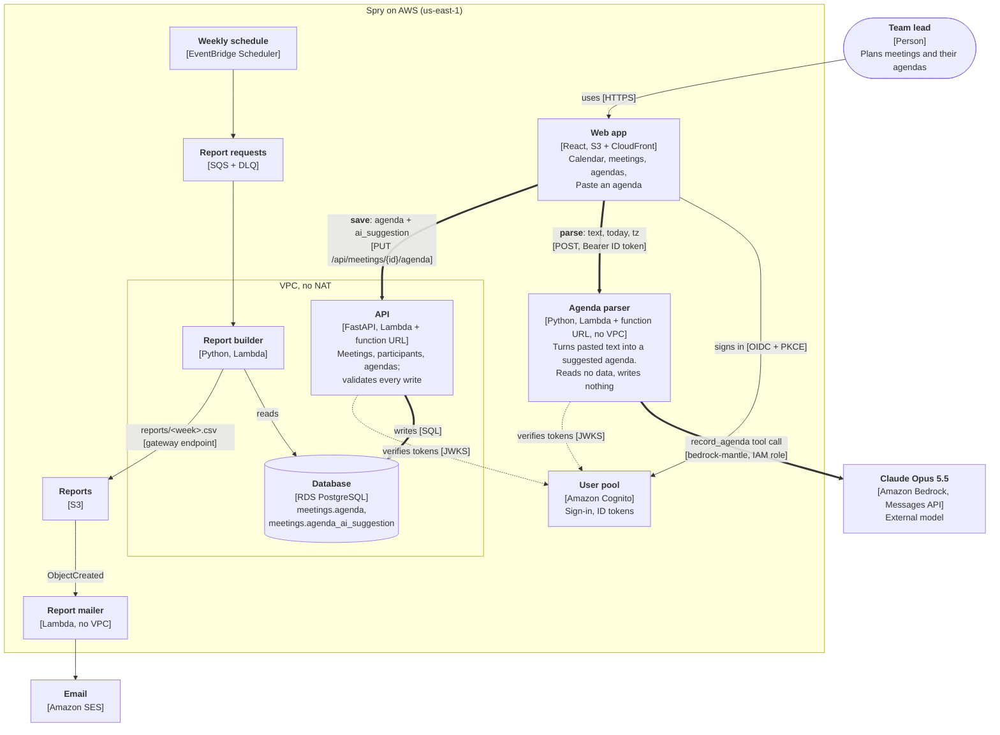

# Architecture: containers (C4, level 2)

The two thick paths are the Paste an agenda feature. **Parse** goes from the browser to the
parser and Bedrock, outside the VPC, and returns only a suggestion. **Save** goes from the
browser to the API and the database inside the VPC, on the path every other write already
takes. The model has no route to the database. See
[ADR 0006](adr/0006-llm-agenda-parsing.md).
